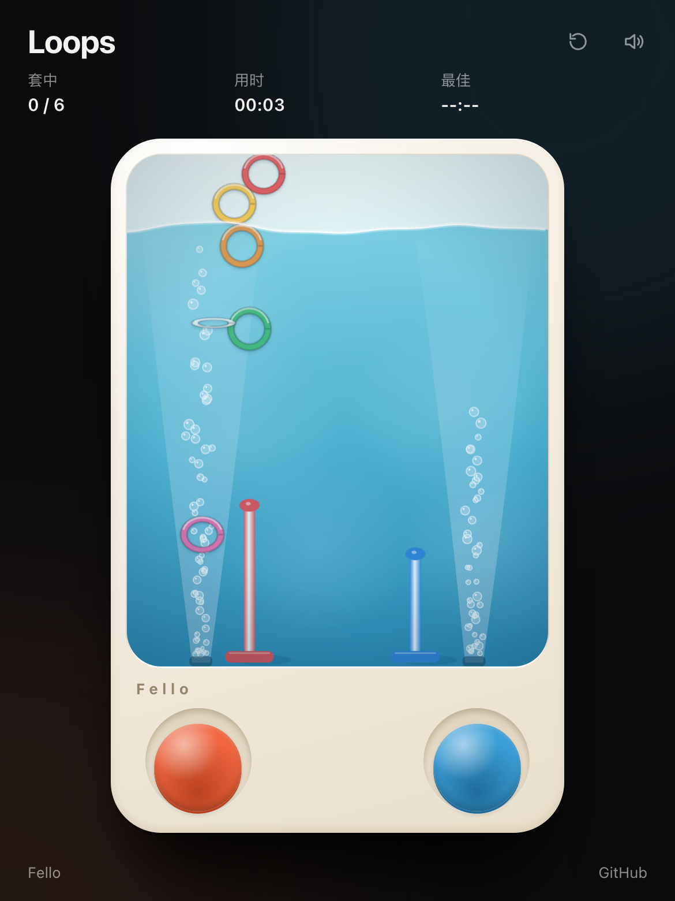

# Loops



在线玩：https://loops.fello.top

童年那台水压套圈掌上机的网页复刻。按住左右两颗按钮喷出水柱，让圈浮起来、漂过去、落到柱子上，六个全部套中就算通关。

## 玩法

- 按住橙色按钮喷左水柱，按住蓝色按钮喷右水柱，两边可以同时按
- 圈有浮力和惯性，松手后会自己往下沉，要算好提前量
- 套中会响一声，手机上会震一下
- 通关后记录用时，最佳成绩存在本机

## 它是这样的

- 整个游戏是一个 `index.html`，双击就能玩
- Canvas 2D 画水箱，120Hz 固定步长模拟圈的浮力、水柱推力、圈与圈的碰撞
- 音效由 Web Audio 实时合成
- 手机竖屏优先，桌面端左右分栏

## 跑起来

```bash
# 直接打开
open index.html
# 或者起个静态服务
npx serve .
```

部署到 Vercel：导入仓库，Framework Preset 选 Other，其余保持默认。

## License

MIT
